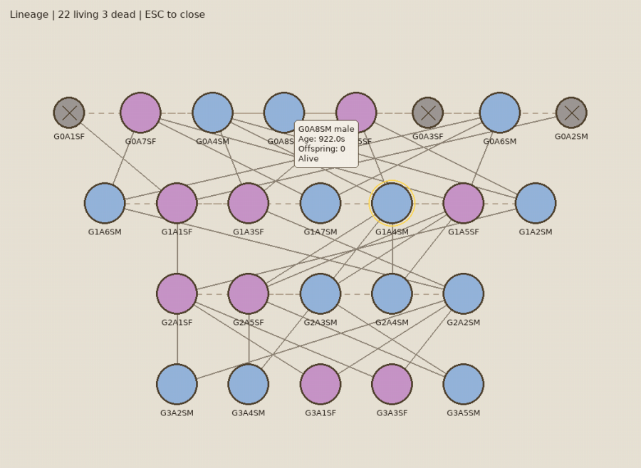
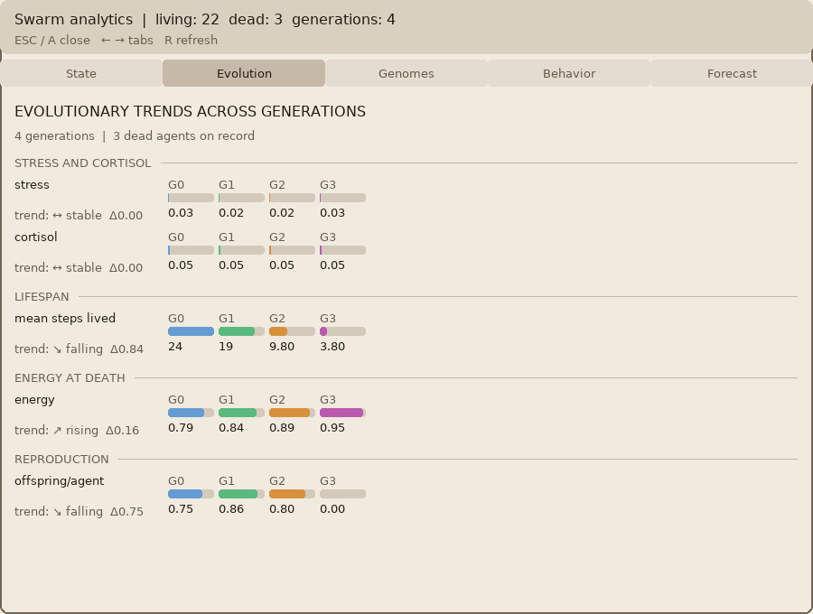

# Chinchilla Colony: Scientific Account of the Experimental Platform

Russian version: [COLONY_SPEC.ru.md](COLONY_SPEC.ru.md)

### 1. Subject

The platform models a population in which each individual is an autonomous NOWA agent. The environment is a cage with zones and normalised resources. The question addressed by a run is the emergence of demographic and social dynamics in the absence of a central policy dispatcher: ties, generational turnover, resource allocation, and extinction risk.

<a id="evolution-in-action"></a>

### Evolution in action

A seeded colony (generator seed 11) bred through this runner, drawn with the existing overlays. Names are colony ids. The full English and Russian galleries are in the README section [Evolution in action](../../../README.md#evolution-in-action).





The theoretical account of the core and the colony analysis in the preprint: [arxiv_NOWA_en.md](../../../Docs/arxiv_NOWA_en.md). The implemented state of the modules: [IMPLEMENTATION_DESCRIPTION.en.md](IMPLEMENTATION_DESCRIPTION.en.md). Subsystem contracts remain in the `SPEC_*.md` files of this directory.

### 2. Composition

| Module | Function |
|---|---|
| `src/colony_agent.py` | Cognitive step, homeostasis, social behaviour, reproduction, mortality |
| `src/simulation_runner.py` | Population tick, births and deaths, resource refill |
| `src/colony_swarm_bridge.py` | Synchronisation with the swarm environment: position, signals, ecology, pair checks |
| `src/colony_gui/` | Display layer; reads snapshots and does not alter the decision |
| `src/colony_storage.py` | Save and load of the runner and of individual state |
| `src/colony_population_observer.py` | Passive snapshots, trends, extinction risk, cohesion |

Executable code of the platform resides in `src/`.

### 3. Invariants

1. The graphical interface and the population observer do not alter the cognitive decision.
2. The canonical display name of an individual has the form `G<generation>A<index>S<sex>`. Regular expression: `^G[0-9]+A[0-9]+S[MFU]$`. Examples: `G0A1SM`, `G2A5SF`.
3. A separate hard lifetime of the colony in seconds is not imposed.
4. Exclusive resources remain exclusive end to end: the lock in `SharedResources` and the visual exclusivity of the wheel and the dust bath in the interface.
5. Death events are appended to JSONL. Default path: `Demo/Colony chinchillas/logs/deaths.jsonl`.
6. Runner lifecycle counters: `births_this_step`, `deaths_this_step`, `total_births`, `total_deaths`.

The individual's homeostatic gate may cancel a cognitively chosen action under critical hunger, thirst, or fatigue. The constraint belongs to the body.

### 4. Observables and life-cycle parameters

Sexual maturity is 900 units of model time; gestation is 300; oestrous-cycle length is 600; estrus is 180; refill of food, hay, and water to 1.0 occurs every 600 units; the old-age step budget is 20 000. Acceptance of mating requires female estrus. Death from old age in colony mode is counted by the step budget; exhaustion and sleep deprivation remain physiological causes. The death journal stores the cause, model time, energy, wakefulness, stress, and cortisol.

### 5. Reproduction

Graphical mode:

```bash
cd "Demo/Colony chinchillas/src"
python gui.py --agents 4
```

Headless run:

```bash
cd "Demo/Colony chinchillas/src"
python gui.py --headless --agents 4 --duration 5
```

Module launch: `python -m colony_gui --agents 4` from the `src` directory.

Verification:

```bash
cd "Demo/Colony chinchillas"
python -m pytest -q tests
```

When the interface shows zero abundance, the cause is established from the latest records in `deaths.jsonl`.

## 6. Documents of the platform

Other documents of this platform:

- [Chinchilla Colony: Implemented State](IMPLEMENTATION_DESCRIPTION.en.md)
- [Specification: Agent Inspector + Death Registry + Lineage Tree](SPEC_AgentInspector_DeathRegistry_LineageTree.en.md)
- [Specification: DeathRegistry + AgentInspector + LineageOverlay](SPEC_AgentInspector_DeathRegistry_LineageTree_v1.1.en.md)
- [SPEC: ChinchillaAgent with NOWA Stack (Current Implementation)](SPEC_ChinchillaAgent_NOWA.en.md)
- [SPEC: Colony GUI (Current Implementation)](SPEC_ColonyGUI.en.md)
- [ColonyPopulationObserver Specification](SPEC_ColonyPopulationObserver.en.md)
- [SPEC: Colony Swarm Bridge (Current Implementation)](SPEC_ColonySwarmBridge.en.md)
- [Specification: the extended "Genome" tab in AgentInspectorOverlay](SPEC_GenomePortrait_InspectorTab.en.md)
- [Specification: integration of ColonyPopulationObserver into ColonyGUI](SPEC_GUI_PopulationStats.en.md)
- [Specification: the extended NOWA tab in AgentInspectorOverlay](SPEC_NowaTab_Extended.en.md)
- [Specification: SwarmAnalyticsOverlay](SPEC_SwarmAnalyticsOverlay.en.md)
