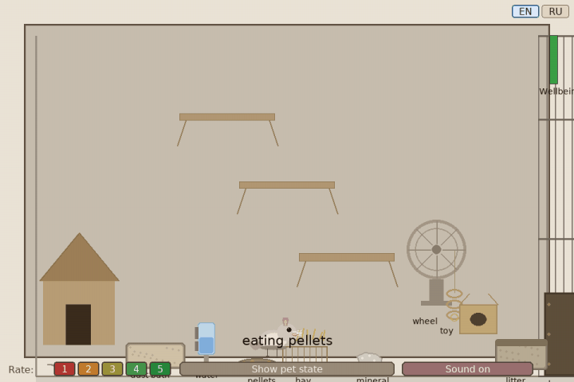

# NOWA Ethological Agent

Russian version: [README.ru.md](README.ru.md)

The platform presents a single individual whose cognitive modules are imported from the NOWA core, while a local layer supplies behavioural chains, action realisation, sound, and display. Scientific account: [Docs/SCIENTIFIC_DESCRIPTION.en.md](Docs/SCIENTIFIC_DESCRIPTION.en.md). Account of the complex: [Docs/SCIENTIFIC_DESCRIPTION.en.md](../../Docs/SCIENTIFIC_DESCRIPTION.en.md).

Launch from the platform directory:

```bash
python src/main.py --lang en
```

The window defaults to English. `--lang ru` or `NOWA_LANG=ru` switches it; press `G` or the separate EN and RU buttons in the window. The active language is highlighted. Checks: `python -m pytest -q tests` from `Demo/Tamagochi Chinchilla`.



The documents `Docs/PHASE2_MEMORY_SYSTEM.md`, `Docs/PHASE3_SCHEDULING_SYSTEM.md`, `Docs/NOWA_INTEGRATION_SPEC.md`, and `Docs/IMPLEMENTATION_SPEC.md` are normative and historical protocols. The current state of the build is the joint presence of core modules and the local ethological layer, including `scheduling_system.py` and `DriveSystem`.
