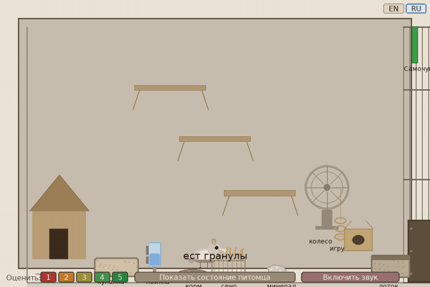

# Этологический агент NOWA

English version: [README.en.md](README.en.md)

Установка предъявляет одну особь, когнитивные модули которой импортируются из ядра NOWA, а локальный слой задаёт поведенческие цепи, реализацию действия, звук и отображение. Научное описание: [Docs/SCIENTIFIC_DESCRIPTION.ru.md](Docs/SCIENTIFIC_DESCRIPTION.ru.md). Описание комплекса: [Docs/SCIENTIFIC_DESCRIPTION.ru.md](../../Docs/SCIENTIFIC_DESCRIPTION.ru.md).

Запуск из каталога установки:

```bash
python src/main.py --lang ru
```

Окно по умолчанию английское. `--lang ru` или `NOWA_LANG=ru` включает русский; в окне — клавиша `G` или отдельные кнопки EN и RU. Активный язык подсвечен. Проверки: `python -m pytest -q tests` из каталога `Demo/Tamagochi Chinchilla`.



Документы `Docs/PHASE2_MEMORY_SYSTEM.md`, `Docs/PHASE3_SCHEDULING_SYSTEM.md`, `Docs/NOWA_INTEGRATION_SPEC.md` и `Docs/IMPLEMENTATION_SPEC.md` являются нормативными и историческими протоколами. Актуальное состояние сборки — одновременное присутствие модулей ядра и локального этологического слоя, включая `scheduling_system.py` и `DriveSystem`.

---
