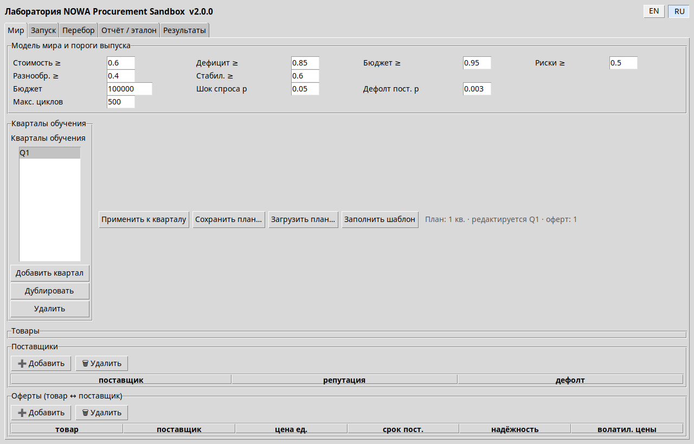
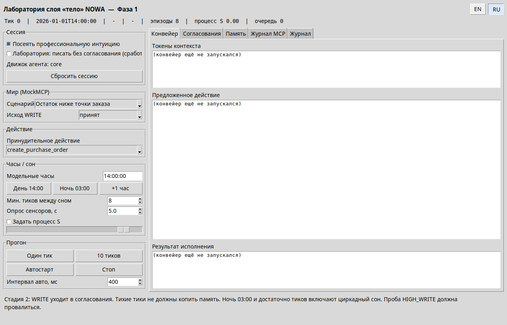
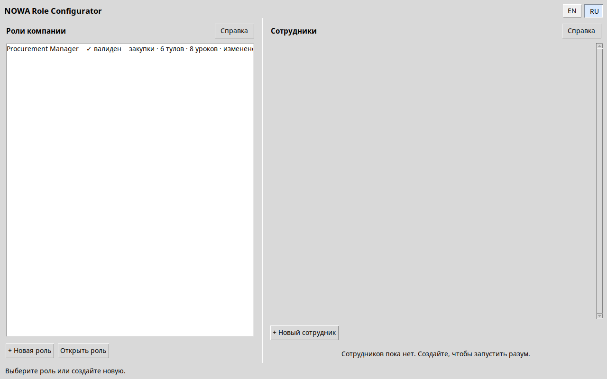

# Виртуальная организация NOWA

English version: [README.en.md](README.en.md)

Установка содержит песочницу закупок и протокольное тело с хостом сотрудников. Контуры не импортируют друг друга. Научное описание, инварианты, учебный план, лабораторные наблюдения и команды: [Docs/SCIENTIFIC_DESCRIPTION.ru.md](Docs/SCIENTIFIC_DESCRIPTION.ru.md). Описание комплекса: [Docs/SCIENTIFIC_DESCRIPTION.ru.md](../../Docs/SCIENTIFIC_DESCRIPTION.ru.md).

Краткий запуск песочницы из каталога установки:

```bash
python src/nowa_sandbox/run_sandbox.py --config configs/default_world.yaml --stage 1a --quarters 30
```

Лаборатория песочницы: `python -m nowa_sandbox.gui_app --lang ru` (либо `run_gui.bat`).



Лаборатория тела: `python -m nowa_body.gui_app --lang ru` (либо `run_body_gui.bat`).



Конфигуратор ролей: `python -m nowa_body.gui_configurator --lang ru` (либо `run_role_configurator.bat`).



В каждой лаборатории две кнопки, EN и RU, и активная подсвечена. Выбор запоминается. `--lang en|ru` перекрывает сохранённое предпочтение на один запуск; иначе действует `NOWA_LANG`, а если её нет — сохранённый выбор. По умолчанию английский.

Проверки: `python -m pytest -m "not slow"`.

Нормативные спецификации в `Docs/` сохраняют контракты модулей. Их предисловия на русском и английском языках отсылают к научному описанию.

---
