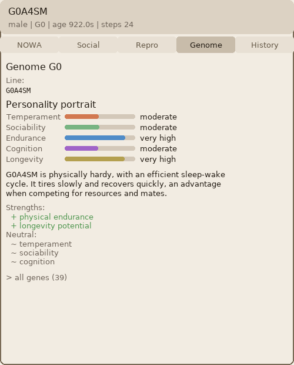
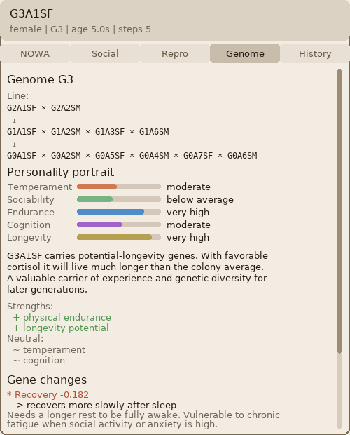
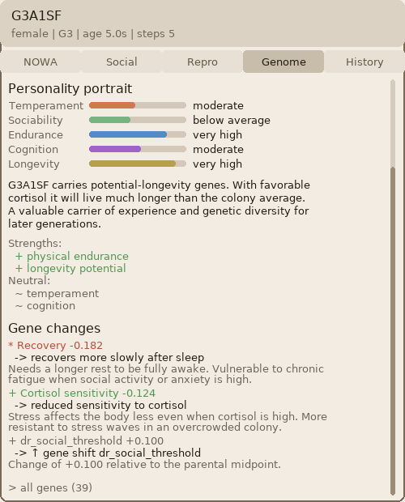

# Specification of Package A — GenomeVector

Russian version: [SPEC_A_GenomeVector.ru.md](SPEC_A_GenomeVector.ru.md)

**Status (27 September 2026).** A core document. The current scientific exposition of the complex, in Russian and in English, is [SCIENTIFIC_DESCRIPTION.en.md](SCIENTIFIC_DESCRIPTION.en.md). The text below retains the wording of its original drafting: a normative module contract or a laboratory record.

**Project:** NOWA (an extension of the existing system)  
**File:** `src/genome.py`  
**Dependencies:** the Python standard library only (`math`, `random`, `dataclasses`, `typing`)  
**Specification version:** 1.0

---

## 1. Purpose

`GenomeVector` is a flat vector of evolvable parameters of a NOWA agent.  
Each gene corresponds to a particular parameter of a biologically motivated module.  
The genome contains no behavioural logic, only numeric parameters with bounds.

The genome is used for:

- initialising an agent through `AgentFactory` (package C)
- crossover and mutation at reproduction (package E)
- niching under selection (package F)

### Colony portraits

Inspector genome tab from a four-generation colony (generator seed 11). The descendant frame lists the recombined line. The gene-change frame is the same agent scrolled to shifts from the parental midpoint. Gallery: [Evolution in action](../README.md#evolution-in-action).

| Founder `G0A4SM` | Descendant `G3A1SF` |
|---|---|
|  |  |



---

## 2. Data structure

### 2.1 GeneDescriptor

```python
@dataclass
class GeneDescriptor:
    key: str           # уникальный идентификатор гена
    module: str        # модуль NOWA к которому относится
    min_val: float     # биологически обоснованный минимум
    max_val: float     # биологически обоснованный максимум
    default: float     # нейтральное значение (baseline организм)
    sigma: float       # типичный шаг мутации (стандартное отклонение)
    description: str   # описание биологического смысла
```

**Constraints on GeneDescriptor:**

- `min_val < max_val` is required
- `min_val <= default <= max_val` is required
- `sigma > 0` is required
- `sigma <= (max_val - min_val) / 2` is recommended, so that clamping is not frequent
- `key` is unique within `GENE_REGISTRY`

### 2.2 GenomeVector

```python
@dataclass
class GenomeVector:
    genes: Dict[str, float]   # key -> значение
    generation: int = 0       # поколение (0 = первичная инициализация)
    lineage_id: str = ""      # идентификатор линии (для трекинга)
```

**Constraints on GenomeVector:**

- `genes` contains a value for **every** key in `GENE_REGISTRY`
- each value satisfies `descriptor.min_val <= value <= descriptor.max_val`
- `generation >= 0`

---

## 3. Gene catalogue (GENE_REGISTRY)

### Group NM — neuromodulators

| key | module | min | max | default | sigma | description |
|---|---|---|---|---|---|---|
| `nm_da_ne_weight` | neuromodulators | -0.4 | 0.0 | -0.2 | 0.05 | DA→NE inhibition in the interaction matrix |
| `nm_ne_da_weight` | neuromodulators | 0.0 | 0.4 | 0.2 | 0.05 | NE→DA facilitation |
| `nm_da_ach_weight` | neuromodulators | -0.5 | -0.1 | -0.3 | 0.05 | DA→ACh inhibition |
| `nm_ach_da_weight` | neuromodulators | -0.5 | -0.1 | -0.3 | 0.05 | ACh→DA inhibition |
| `nm_acc_k_ne` | neuromodulators | 0.2 | 1.0 | 0.5 | 0.10 | ACC sensitivity to norepinephrine |
| `nm_acc_k_cort` | neuromodulators | 0.3 | 1.2 | 0.7 | 0.10 | ACC sensitivity to cortisol |
| `nm_acc_k_ht` | neuromodulators | 0.1 | 0.6 | 0.35 | 0.05 | inhibition of conflict by serotonin |
| `nm_decay_half_life` | neuromodulators | 45.0 | 180.0 | 90.0 | 15.0 | neuromodulator half-life (seconds) |

### Group AF — affective space

| key | module | min | max | default | sigma | description |
|---|---|---|---|---|---|---|
| `af_decay_valence` | affective_space | 0.80 | 0.98 | 0.92 | 0.03 | inertia of mood |
| `af_decay_arousal` | affective_space | 0.60 | 0.92 | 0.80 | 0.05 | rate at which arousal settles |
| `af_decay_dominance` | affective_space | 0.88 | 0.99 | 0.97 | 0.02 | persistence of the sense of control |
| `af_decay_stress` | affective_space | 0.55 | 0.88 | 0.75 | 0.05 | rate of stress relief |
| `af_decay_curiosity` | affective_space | 0.60 | 0.90 | 0.78 | 0.05 | fading of interest without reinforcement |
| `af_decay_trust` | affective_space | 0.85 | 0.99 | 0.95 | 0.02 | inertia of trust |
| `af_decay_attachment` | affective_space | 0.85 | 0.99 | 0.93 | 0.02 | inertia of attachment |
| `af_lambda_reg` | affective_space | 0.01 | 0.10 | 0.05 | 0.01 | strength of homeostatic return |
| `af_baseline_adapt_rate` | affective_space | 0.0 | 0.01 | 0.002 | 0.001 | rate of adaptation of the emotional baseline |

### Group WK — wakefulness and the circadian rhythm

| key | module | min | max | default | sigma | description |
|---|---|---|---|---|---|---|
| `wk_circadian_amplitude` | wakefulness | 0.1 | 0.5 | 0.3 | 0.05 | amplitude of the daily rhythm |
| `wk_circadian_phase` | wakefulness | -1.57 | 1.57 | 0.0 | 0.30 | phase shift (chronotype) |
| `wk_accumulation_factor` | wakefulness | 0.5 | 2.0 | 1.0 | 0.20 | multiplier of the rate of fatigue accumulation |
| `wk_recovery_factor` | wakefulness | 0.5 | 2.0 | 1.0 | 0.20 | multiplier of the rate of recovery |

### Group DR — drives (autonomous organism)

| key | module | min | max | default | sigma | description |
|---|---|---|---|---|---|---|
| `dr_curiosity_baseline` | autonomous | 0.05 | 0.40 | 0.18 | 0.05 | baseline level of curiosity |
| `dr_social_drive_baseline` | autonomous | 0.05 | 0.45 | 0.22 | 0.05 | baseline social need |
| `dr_exploration_baseline` | autonomous | 0.05 | 0.35 | 0.12 | 0.04 | baseline level of exploration |
| `dr_energy_recovery_rate` | autonomous | 0.02 | 0.10 | 0.05 | 0.01 | rate of energy replenishment |
| `dr_cognitive_cost` | autonomous | 0.01 | 0.06 | 0.03 | 0.01 | energetic cost of cognition |
| `dr_curiosity_threshold` | autonomous | 0.30 | 0.65 | 0.45 | 0.05 | threshold for activating curiosity |
| `dr_social_threshold` | autonomous | 0.35 | 0.70 | 0.50 | 0.05 | threshold for social activation |

### Group LR — learning and memory

| key | module | min | max | default | sigma | description |
|---|---|---|---|---|---|---|
| `lr_gamma` | value_layer | 0.80 | 0.99 | 0.95 | 0.02 | discount of future reward |
| `lr_alpha_online` | value_layer | 0.01 | 0.08 | 0.03 | 0.01 | online learning rate |
| `lr_tonic_slow_rate` | value_layer | 0.003 | 0.03 | 0.01 | 0.003 | inertia of tonic dopamine |
| `lr_similarity_threshold` | hippocampus | 0.40 | 0.80 | 0.60 | 0.05 | similarity threshold for activating memory |
| `lr_consolidation_threshold` | sleep | 0.10 | 0.60 | 0.30 | 0.05 | minimum threshold for consolidation |

### Group IM — imagination

| key | module | min | max | default | sigma | description |
|---|---|---|---|---|---|---|
| `im_goal_bias` | imagination | 0.10 | 0.70 | 0.35 | 0.08 | degree to which imagination is oriented toward a goal |
| `im_confidence_decay` | imagination | 0.70 | 0.99 | 0.90 | 0.05 | decay of confidence with trajectory depth |
| `im_novelty_weight` | imagination | 0.10 | 0.70 | 0.40 | 0.08 | weight of novelty when imagined trajectories are evaluated |
| `im_value_blend` | imagination | 0.30 | 0.90 | 0.60 | 0.08 | balance between memory and imagination |

---

## 4. API of the class GenomeVector

### 4.1 Initialisation

```python
@classmethod
def default(cls) -> "GenomeVector":
    """Создать геном с дефолтными значениями (нейтральный агент)."""

@classmethod
def random(cls, rng: random.Random = None) -> "GenomeVector":
    """
    Создать случайный геном.
    Каждый ген = равномерное распределение в [min_val, max_val].
    """

@classmethod
def from_dict(cls, data: dict) -> "GenomeVector":
    """
    Восстановить геном из словаря.
    Ключи не из GENE_REGISTRY игнорируются.
    Отсутствующие ключи заполняются default значениями.
    Значения вне диапазона клампируются с предупреждением.
    """
```

### 4.2 Mutation

```python
def mutate(
    self,
    rate: float = 0.05,
    sigma_scale: float = 1.0,
    rng: random.Random = None,
) -> "GenomeVector":
    """
    Создать мутировавшую копию генома.
    
    Алгоритм для каждого гена:
        1. Бросить монету с вероятностью rate
        2. Если мутация: value += N(0, descriptor.sigma * sigma_scale)
        3. Клампировать в [min_val, max_val]
    
    Аргументы:
        rate: вероятность мутации каждого гена [0.0, 1.0]
        sigma_scale: масштаб шума (1.0 = номинальный)
        rng: генератор случайных чисел (None = random.Random())
    
    Возвращает: новый GenomeVector (исходный не изменяется)
    
    Ограничения:
        - rate клампируется в [0.0, 1.0]
        - sigma_scale клампируется в [0.1, 5.0]
        - при rate=0.0 возвращается точная копия
        - при rate=1.0 мутируют все гены
    """
```

### 4.3 Crossover

```python
def crossover(
    self,
    other: "GenomeVector",
    alpha: float = 0.5,
    mode: str = "arithmetic",
    rng: random.Random = None,
) -> Tuple["GenomeVector", "GenomeVector"]:
    """
    Скрестить два генома, получить двух потомков.
    
    Режимы:
        "arithmetic":
            child_a[i] = alpha * self[i] + (1-alpha) * other[i]
            child_b[i] = (1-alpha) * self[i] + alpha * other[i]
            
        "uniform":
            для каждого гена независимо:
                child_a[i] = self[i] или other[i] с вероятностью 0.5
                child_b[i] = противоположный родитель
                
        "sbx" (simulated binary crossover, eta=2):
            сохраняет дисперсию популяции
            рекомендуется для числовых параметров
    
    Аргументы:
        other: второй родительский геном
        alpha: вес первого родителя для "arithmetic" [0.0, 1.0]
        mode: "arithmetic" | "uniform" | "sbx"
        rng: генератор случайных чисел
    
    Возвращает: кортеж (child_a, child_b)
    
    Ограничения:
        - alpha клампируется в [0.0, 1.0]
        - неизвестный mode вызывает ValueError
        - generation потомков = max(self.generation, other.generation) + 1
        - все значения потомков клампируются в допустимые диапазоны
    """
```

### 4.4 Distance and similarity

```python
def distance(self, other: "GenomeVector") -> float:
    """
    Нормированное евклидово расстояние в пространстве генов.
    
    Нормировка: каждый ген масштабируется в [0, 1] перед вычислением.
        scaled[i] = (value[i] - min_val[i]) / (max_val[i] - min_val[i])
    
    Расстояние = sqrt(sum((scaled_a[i] - scaled_b[i])^2)) / sqrt(N)
    
    Диапазон результата: [0.0, 1.0]
    0.0 = идентичные геномы
    1.0 = максимально различные геномы
    """

def similarity(self, other: "GenomeVector") -> float:
    """Возвращает 1.0 - distance(other)."""
```

### 4.5 Expansion into module parameters

```python
def to_agent_params(self) -> dict:
    """
    Развернуть геном в словарь параметров для AgentFactory.
    
    Возвращает структуру:
    {
        "affective_space": {
            "axis_decay": {
                "valence": genes["af_decay_valence"],
                "arousal": genes["af_decay_arousal"],
                ...
            },
            "lambda_reg": genes["af_lambda_reg"],
            "baseline_adapt_rate": genes["af_baseline_adapt_rate"],
        },
        "wakefulness": {
            "circadian_amplitude": genes["wk_circadian_amplitude"],
            "circadian_phase": genes["wk_circadian_phase"],
            "accumulation_rate_factor": genes["wk_accumulation_factor"],
            "recovery_rate_factor": genes["wk_recovery_factor"],
        },
        "neuromodulators": {
            "interaction_overrides": {
                "da_ne": genes["nm_da_ne_weight"],
                "ne_da": genes["nm_ne_da_weight"],
                "da_ach": genes["nm_da_ach_weight"],
                "ach_da": genes["nm_ach_da_weight"],
            },
            "acc_k_ne": genes["nm_acc_k_ne"],
            "acc_k_cort": genes["nm_acc_k_cort"],
            "acc_k_ht": genes["nm_acc_k_ht"],
            "decay_half_life": genes["nm_decay_half_life"],
        },
        "autonomous": {
            "drive_baselines": {
                "curiosity": genes["dr_curiosity_baseline"],
                "social_drive": genes["dr_social_drive_baseline"],
                "exploration": genes["dr_exploration_baseline"],
            },
            "drive_thresholds": {
                "curiosity": genes["dr_curiosity_threshold"],
                "social_drive": genes["dr_social_threshold"],
            },
            "energy_recovery_rate": genes["dr_energy_recovery_rate"],
            "cognitive_cost": genes["dr_cognitive_cost"],
        },
        "value_layer": {
            "gamma_default": genes["lr_gamma"],
            "alpha_online_default": genes["lr_alpha_online"],
            "tonic_slow_rate": genes["lr_tonic_slow_rate"],
        },
        "hippocampus": {
            "similarity_threshold": genes["lr_similarity_threshold"],
        },
        "sleep": {
            "consolidation_threshold": genes["lr_consolidation_threshold"],
        },
        "imagination": {
            "goal_bias": genes["im_goal_bias"],
            "confidence_decay": genes["im_confidence_decay"],
            "state_novelty_weight": genes["im_novelty_weight"],
            "value_blend": genes["im_value_blend"],
        },
    }
    """
```

### 4.6 Serialisation

```python
def to_dict(self) -> dict:
    """
    Сериализовать в словарь.
    Возвращает:
    {
        "version": "1.0",
        "generation": int,
        "lineage_id": str,
        "genes": {key: value, ...}
    }
    """

def to_array(self) -> List[float]:
    """
    Вернуть значения генов как список в детерминированном порядке.
    Порядок = порядок объявления в GENE_REGISTRY.
    Используется для математических операций (numpy совместим).
    """

@classmethod
def from_array(cls, array: List[float], generation: int = 0) -> "GenomeVector":
    """
    Восстановить геном из списка.
    Порядок должен совпадать с to_array().
    Значения клампируются в допустимые диапазоны.
    Raises ValueError если len(array) != len(GENE_REGISTRY).
    """
```

### 4.7 Diagnostics

```python
def validate(self) -> List[str]:
    """
    Проверить корректность генома.
    Возвращает список строк с предупреждениями (пустой = всё ок).
    Проверяет: диапазоны, NaN, Inf.
    """

def summary(self) -> dict:
    """
    Краткая статистика по группам генов.
    {
        "NM": {"mean": float, "std": float, "deviation_from_default": float},
        "AF": {...},
        ...
    }
    """
```

---

## 5. What the genome does not include

The following parameters are excluded on purpose and are the same for every agent:

- The set of available actions is determined by the environment
- Hippocampal size is the same, so that comparison stays fair
- Signs in the neuromodulator interaction matrix: only the weights change, not the topology
- The structure of the module network: the architecture is fixed
- Parameters of the SWS/REM partition of sleep: the sleep mechanics are the same

---

## 6. Implementation constraints

1. `GenomeVector` is **immutable** after creation. `mutate()` and `crossover()` return new objects.
2. There are no dependencies beyond the Python standard library.
3. Every operation is deterministic when `rng` is fixed.
4. `to_dict()` / `from_dict()` is a complete round-trip without loss.
5. `from_dict()` on an incomplete dictionary fills the missing genes from `default` (backward compatibility).
6. The file `genome.py` imports no NOWA module, so there are no cyclic dependencies.

---

## 7. Test cases

### TC-01: Creating the default genome

```python
genome = GenomeVector.default()

# Все гены присутствуют
assert set(genome.genes.keys()) == set(GENE_REGISTRY.keys())

# Значения равны default
for key, desc in GENE_REGISTRY.items():
    assert genome.genes[key] == desc.default, f"TC-01 fail: {key}"

# Валидация чистая
assert genome.validate() == []

# generation = 0
assert genome.generation == 0
```

### TC-02: Mutation does not change the original

```python
original = GenomeVector.default()
mutated = original.mutate(rate=1.0, sigma_scale=2.0, rng=random.Random(42))

# Оригинал не изменён
for key in GENE_REGISTRY:
    assert original.genes[key] == GENE_REGISTRY[key].default

# Мутированный отличается
assert original.genes != mutated.genes

# Все значения в диапазоне
for key, desc in GENE_REGISTRY.items():
    assert desc.min_val <= mutated.genes[key] <= desc.max_val, f"TC-02 range fail: {key}"
```

### TC-03: Mutation at `rate=0` is an exact copy

```python
genome = GenomeVector.default()
copy = genome.mutate(rate=0.0, rng=random.Random(0))
assert genome.genes == copy.genes
```

### TC-04: Arithmetic crossover

```python
rng = random.Random(0)
a = GenomeVector.random(rng)
b = GenomeVector.random(rng)

child_a, child_b = a.crossover(b, alpha=0.5, mode="arithmetic")

# Потомки между родителями
for key in GENE_REGISTRY:
    val_a = a.genes[key]
    val_b = b.genes[key]
    lo, hi = min(val_a, val_b), max(val_a, val_b)
    # При alpha=0.5 оба потомка должны быть средним
    assert abs(child_a.genes[key] - (0.5 * val_a + 0.5 * val_b)) < 1e-9

# generation = max(0, 0) + 1 = 1
assert child_a.generation == 1
assert child_b.generation == 1
```

### TC-05: Uniform crossover — each gene comes from one parent

```python
rng = random.Random(42)
a = GenomeVector.default()
b = GenomeVector.random(rng)
child_a, child_b = a.crossover(b, mode="uniform", rng=random.Random(42))

for key in GENE_REGISTRY:
    # Каждый ген потомка точно равен одному из родителей
    val = child_a.genes[key]
    assert val == a.genes[key] or val == b.genes[key], f"TC-05 fail: {key}"
    # child_b берёт противоположный
    other_val = child_b.genes[key]
    if val == a.genes[key]:
        assert other_val == b.genes[key]
    else:
        assert other_val == a.genes[key]
```

### TC-06: Distance

```python
a = GenomeVector.default()
b = GenomeVector.default()

# Расстояние до себя = 0
assert a.distance(a) == 0.0
assert a.distance(b) == 0.0

# Симметрия
c = GenomeVector.random(random.Random(7))
assert abs(a.distance(c) - c.distance(a)) < 1e-9

# Диапазон [0, 1]
assert 0.0 <= a.distance(c) <= 1.0

# Максимальное расстояние при полярных геномах
min_genome = GenomeVector(genes={k: d.min_val for k, d in GENE_REGISTRY.items()})
max_genome = GenomeVector(genes={k: d.max_val for k, d in GENE_REGISTRY.items()})
assert abs(min_genome.distance(max_genome) - 1.0) < 1e-9
```

### TC-07: Serialisation round-trip

```python
rng = random.Random(13)
genome = GenomeVector.random(rng)
genome_dict = genome.to_dict()
restored = GenomeVector.from_dict(genome_dict)

assert genome.genes == restored.genes
assert genome.generation == restored.generation
assert genome.lineage_id == restored.lineage_id
```

### TC-08: `to_array` / `from_array` round-trip

```python
genome = GenomeVector.random(random.Random(99))
array = genome.to_array()

assert len(array) == len(GENE_REGISTRY)

restored = GenomeVector.from_array(array)
assert genome.genes == restored.genes
```

### TC-09: `from_array` with the wrong length

```python
try:
    GenomeVector.from_array([0.1, 0.2])  # слишком короткий
    assert False, "должен вызвать ValueError"
except ValueError:
    pass
```

### TC-10: `to_agent_params` contains every key

```python
genome = GenomeVector.default()
params = genome.to_agent_params()

# Все ожидаемые модули присутствуют
required_modules = [
    "affective_space", "wakefulness", "neuromodulators",
    "autonomous", "value_layer", "hippocampus", "sleep", "imagination"
]
for module in required_modules:
    assert module in params, f"TC-10: отсутствует модуль {module}"

# Значения соответствуют генам
assert params["affective_space"]["axis_decay"]["valence"] == genome.genes["af_decay_valence"]
assert params["value_layer"]["gamma_default"] == genome.genes["lr_gamma"]
assert params["wakefulness"]["circadian_amplitude"] == genome.genes["wk_circadian_amplitude"]
```

### TC-11: `validate` detects violations

```python
genome = GenomeVector.default()
genome.genes["lr_gamma"] = 1.5  # вне диапазона

warnings = genome.validate()
assert len(warnings) > 0
assert any("lr_gamma" in w for w in warnings)
```

### TC-12: crossover with an unknown mode

```python
a = GenomeVector.default()
b = GenomeVector.default()
try:
    a.crossover(b, mode="unknown_mode")
    assert False, "должен вызвать ValueError"
except ValueError:
    pass
```

### TC-13: Determinism with a fixed `rng`

```python
genome = GenomeVector.default()
m1 = genome.mutate(rate=0.3, rng=random.Random(42))
m2 = genome.mutate(rate=0.3, rng=random.Random(42))
assert m1.genes == m2.genes
```

### TC-14: `summary` contains every group

```python
genome = GenomeVector.default()
s = genome.summary()

for group in ["NM", "AF", "WK", "DR", "LR", "IM"]:
    assert group in s
    assert "mean" in s[group]
    assert "std" in s[group]
    assert "deviation_from_default" in s[group]
```

---

## 8. Notes for the implementing agent

- Implement `GENE_REGISTRY` as an `OrderedDict` or as a list, so that the order in `to_array()` is deterministic.
- SBX crossover: use eta=2 (the standard value for continuous parameters).
- `lineage_id` on creation through `default()` or `random()` is the empty string; on `crossover()` it is `f"{parent_a.lineage_id}x{parent_b.lineage_id}"` (truncate to 64 characters).
- Every method must be a pure function, with no side effects other than the one that is stated (`rng` is modified).
- Python version: 3.10 or newer. Numpy is not a required dependency (it is optional for `to_array`).
