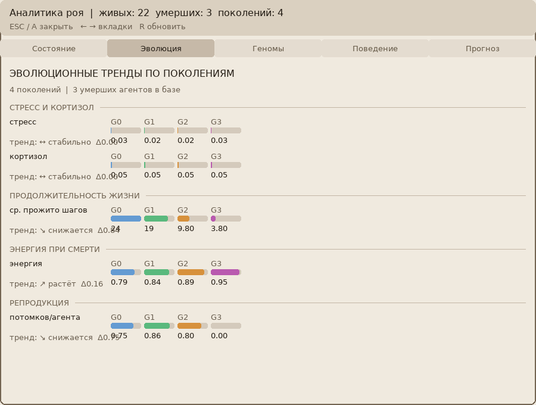
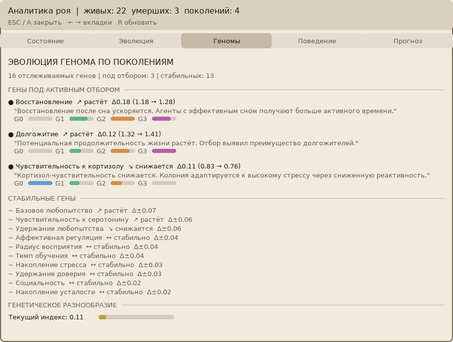
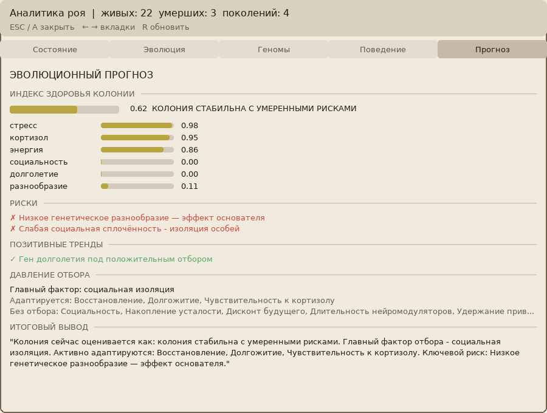

# Спецификация пакета F v2 — Emergent Evolution

English version: [SPEC_F_EmergentEvolution_v2.en.md](SPEC_F_EmergentEvolution_v2.en.md)

**Статус (27 сентября 2026 г.).** Документ ядра. Актуальное научное изложение комплекса на русском и английском языках приведено в [SCIENTIFIC_DESCRIPTION.ru.md](SCIENTIFIC_DESCRIPTION.ru.md). Текст ниже сохраняет формулировки исходной редакции: это нормативный контракт модуля либо лабораторная запись.

**Проект:** NOWA (расширение существующего)  
**Файлы:** `src/reproduction.py`, `src/mortality.py`, `src/ecology.py`  
**Зависимости:** пакеты A-E  
**Версия спецификации:** 2.0  
**Принципиальное отличие от v1:** нет центрального оркестратора. Эволюция emergent — из автономных решений агентов.

---

## 1. Философия

В природе нет EvolutionLoop. Есть агенты которые:
- накапливают ресурсы или истощаются
- чувствуют влечение к другим агентам
- принимают решение о размножении самостоятельно
- стареют и умирают

Среда (`SwarmEnvironment`) остаётся физическим пространством.  
Три новых компонента добавляются к каждому агенту и к среде:

- `ReproductiveSystem` — влечение, совместимость, рекомбинация (на агенте)
- `MortalitySystem` — старение, смерть (на агенте)
- `EcologyLayer` — ресурсы среды, конкуренция (в среде)

Никто не решает кто выживет. Это проявляется само.

### Прогон колонии

Аналитика роя колонии из четырёх поколений (зерно генератора 11): столбцы по поколениям, треки генов и прогноз. Галерея: [Эволюция в действии](../README.md#evolyutsiya-v-deystvii).

| Поколения | Треки генов |
|---|---|
|  |  |



---

## 2. Компонент 1 — ReproductiveSystem

**Файл:** `src/reproduction.py`  
Автономная система размножения. Живёт на агенте как атрибут.

### 2.1 Структура

```python
@dataclass
class ReproductiveSystem:
    """
    Автономная система размножения агента.
    Не знает о других агентах — только о своём состоянии.
    """
    reproductive_drive: float = 0.0      # [0.0, 1.0] — текущее влечение
    drive_threshold: float = 0.7         # порог для готовности к размножению
    drive_decay: float = 0.01            # затухание влечения за шаг
    drive_recovery_rate: float = 0.05    # восстановление при хорошем состоянии
    cooldown_steps: int = 0              # шагов до следующей возможности
    cooldown_duration: int = 50          # шагов восстановления после размножения
    total_offspring: int = 0             # сколько потомков произведено за жизнь
    last_reproduction_step: int = -1     # шаг последнего размножения
```

### 2.2 Обновление влечения

```python
def update(
    self,
    energy: float,          # [0.0, 1.0] — энергия агента
    valence: float,         # [-1.0, 1.0] — аффективное состояние
    cortisol: float,        # [0.0, 1.0] — уровень стресса
    lived_steps: int,       # возраст агента
    resource_share: float,  # [0.0, 1.0] — доля ресурсов среды доступная агенту
) -> None:
    """
    Обновить reproductive_drive за один шаг.
    
    Биологическая модель:
        drive растёт когда: высокая энергия, позитивный аффект, низкий стресс,
                            достаточно ресурсов
        drive падает когда: низкая энергия, стресс, кулдаун активен, нет ресурсов
    
    Формула:
        favorable = (energy * 0.4) + (max(0, valence) * 0.3) + 
                    ((1 - cortisol) * 0.2) + (resource_share * 0.1)
        
        delta = favorable * drive_recovery_rate - drive_decay
        reproductive_drive = clamp(reproductive_drive + delta, 0.0, 1.0)
        
        Если cooldown_steps > 0: cooldown_steps -= 1, drive = 0.0
    
    Ограничения:
        - при lived_steps < MIN_REPRODUCTIVE_AGE: drive = 0.0
        - при cooldown_steps > 0: drive принудительно = 0.0
    """

def is_ready(self) -> bool:
    """
    Готов ли агент к размножению.
    reproductive_drive >= drive_threshold и cooldown_steps == 0
    """

def register_reproduction(self, current_step: int) -> None:
    """
    Зарегистрировать факт размножения.
    Сбрасывает drive, запускает cooldown, инкрементирует total_offspring.
    """

def snapshot(self) -> dict:
def to_dict(self) -> dict:
@classmethod
def from_dict(cls, data: dict) -> "ReproductiveSystem":
```

### 2.3 Совместимость между агентами

```python
def compute_compatibility(
    agent_a_snapshot: dict,
    agent_b_snapshot: dict,
) -> float:
    """
    Вычислить репродуктивную совместимость двух агентов.
    
    Принимает словари-снапшоты агентов (не сами объекты).
    
    Компоненты совместимости:
    
    1. genome_distance_bonus:
       Агенты со средним генетическим расстоянием привлекательнее
       (избегание инбридинга + избегание чужих).
       optimal_distance = 0.3
       genome_bonus = 1.0 - abs(genome_distance - optimal_distance) / optimal_distance
       genome_bonus клампируется в [0.0, 1.0]
    
    2. affective_resonance:
       Схожее валентное состояние притягивает (birds of a feather).
       resonance = 1.0 - abs(valence_a - valence_b) / 2.0
    
    3. stress_compatibility:
       Низкий стресс у обоих → высокая совместимость.
       stress_compat = (1.0 - cortisol_a) * (1.0 - cortisol_b)
    
    4. drive_alignment:
       Оба должны хотеть размножаться.
       drive_align = drive_a * drive_b
    
    Итоговая совместимость:
        compatibility = (
            genome_bonus * 0.25 +
            affective_resonance * 0.25 +
            stress_compatibility * 0.25 +
            drive_alignment * 0.25
        )
    
    Возвращает: float в [0.0, 1.0]
    
    Ограничения:
        - если genome_distance недоступен → genome_bonus = 0.5 (нейтральный)
        - функция чистая (pure function), без побочных эффектов
    """
```

### 2.4 Константы

```python
REPRODUCTION_VERSION = "1.0"
MIN_REPRODUCTIVE_AGE = 100          # минимум шагов до половой зрелости
MIN_COMPATIBILITY_THRESHOLD = 0.4   # минимальная совместимость для размножения
REPRODUCTION_ENERGY_COST = 0.3      # энергия затраченная на размножение
```

---

## 3. Компонент 2 — MortalitySystem

**Файл:** `src/mortality.py`  
Система старения и смерти. Живёт на агенте как атрибут.

### 3.1 Структура

```python
@dataclass
class MortalitySystem:
    """
    Автономная система старения и смерти.
    """
    max_lifespan_steps: int = 10000    # максимальный возраст (геномный параметр)
    critical_energy_threshold: float = 0.05   # ниже — смерть от истощения
    critical_wakefulness_threshold: float = 0.95  # выше — смерть от истощения
    senescence_start_fraction: float = 0.7   # с какого % жизни начинается старение
    
    # Текущее состояние
    vitality: float = 1.0             # [0.0, 1.0] — жизнеспособность
    senescence_rate: float = 0.0      # текущая скорость старения
    cause_of_death: str = ""          # причина смерти если умер
    death_step: int = -1              # шаг смерти
```

### 3.2 Обновление

```python
def update(
    self,
    energy: float,
    wakefulness: float,
    lived_steps: int,
    cortisol_mean: float,    # средний кортизол за жизнь (из cortisol_history)
) -> bool:
    """
    Обновить состояние за один шаг.
    
    Возвращает True если агент умер на этом шаге.
    
    Механизм старения:
        age_fraction = lived_steps / max_lifespan_steps
        если age_fraction >= senescence_start_fraction:
            senescence_rate = (age_fraction - senescence_start_fraction) /
                              (1.0 - senescence_start_fraction)
            vitality -= senescence_rate * 0.001 * (1.0 + cortisol_mean)
    
    Проверка смерти (в порядке приоритета):
        1. energy <= critical_energy_threshold → cause = "exhaustion"
        2. wakefulness >= critical_wakefulness_threshold → cause = "sleep_deprivation"
        3. lived_steps >= max_lifespan_steps → cause = "old_age"
        4. vitality <= 0.0 → cause = "senescence"
    
    При смерти: death_step = lived_steps, возвращает True.
    
    Ограничения:
        - vitality клампируется в [0.0, 1.0]
        - умерший агент не может "ожить" — повторный update всегда False
    """

def is_dead(self) -> bool:
    """death_step >= 0"""

def get_age_fraction(self, lived_steps: int) -> float:
    """lived_steps / max_lifespan_steps, клампировать в [0.0, 1.0]"""

def snapshot(self) -> dict:
def to_dict(self) -> dict:
@classmethod
def from_dict(cls, data: dict) -> "MortalitySystem":
```

### 3.3 Геномный параметр продолжительности жизни

В `genome.py` добавить ген:

| ключ | модуль | min | max | default | sigma | описание |
|---|---|---|---|---|---|---|
| `lt_max_lifespan_factor` | mortality | 0.5 | 2.0 | 1.0 | 0.2 | множитель максимального возраста |

Базовое значение `max_lifespan_steps` задаётся в конфиге среды.  
Реальный возраст агента: `base_lifespan * genome.genes["lt_max_lifespan_factor"]`

Группа `LT` (lifespan/time) — новая группа генома.

### 3.4 Константы

```python
MORTALITY_VERSION = "1.0"
BASE_LIFESPAN_STEPS = 5000
```

---

## 4. Компонент 3 — EcologyLayer

**Файл:** `src/ecology.py`  
Ресурсная система среды. Добавляется к `SwarmEnvironment`.

### 4.1 Концепция ресурсов

Среда содержит конечное количество ресурсов.  
Больше агентов → меньше ресурсов на каждого → замедляется рост drive и энергии.  
Это единственный механизм регуляции популяции — не искусственный лимит.

```python
@dataclass
class EcologyLayer:
    """
    Ресурсная система среды.
    Не управляет агентами — только предоставляет информацию о ресурсах.
    """
    total_resources: float = 1000.0    # суммарные ресурсы среды
    resource_regen_rate: float = 0.1   # ресурсов восстанавливается за шаг
    resource_per_agent_base: float = 10.0  # базовое потребление агента за шаг
    current_resources: float = 1000.0  # текущий уровень ресурсов
```

### 4.2 API

```python
def compute_resource_share(self, agent_count: int) -> float:
    """
    Вычислить долю ресурсов доступную одному агенту.
    
    share = current_resources / (agent_count * resource_per_agent_base)
    share клампируется в [0.0, 1.0]
    
    При agent_count = 0: возвращает 1.0
    """

def consume(self, agent_count: int) -> float:
    """
    Потребить ресурсы за один тик.
    
    consumed = agent_count * resource_per_agent_base
    current_resources -= consumed
    current_resources += resource_regen_rate
    current_resources = clamp(current_resources, 0.0, total_resources)
    
    Возвращает: resource_share после потребления.
    """

def snapshot(self) -> dict:
def to_dict(self) -> dict:
@classmethod
def from_dict(cls, data: dict) -> "EcologyLayer":
```

---

## 5. Интеграция в SwarmEnvironment

`SwarmEnvironment` расширяется тремя новыми методами. Никакой оркестрации — только обработка событий.

### 5.1 Новые атрибуты SwarmEnvironment

```python
self.ecology: EcologyLayer           # ресурсная система
self.factory: Optional[AgentFactory] # для создания потомков
self.births_this_step: int = 0       # статистика рождений
self.deaths_this_step: int = 0       # статистика смертей
self.total_births: int = 0
self.total_deaths: int = 0
```

### 5.2 Расширение tick()

В конце каждого тика (после шагов агентов) среда:

```
1. ecology.consume(agent_count)  → resource_share
2. Для каждого активного агента:
   a. _update_agent_vitality(agent, resource_share)
   b. _check_mortality(agent)  → если умер: remove_agent(agent_id)
3. _check_reproduction_pairs()  → для каждой пары готовых агентов
```

### 5.3 _update_agent_vitality

```python
def _update_agent_vitality(self, agent: Any, resource_share: float) -> None:
    """
    Обновить системы жизнеобеспечения агента.
    
    1. Обновить ReproductiveSystem если есть:
       agent.reproductive_system.update(
           energy=..., valence=..., cortisol=...,
           lived_steps=..., resource_share=resource_share
       )
    
    2. Обновить MortalitySystem если есть:
       agent.mortality_system.update(
           energy=..., wakefulness=..., lived_steps=..., cortisol_mean=...
       )
    
    Все в try/except — ошибка молча игнорируется.
    Читает из agent.autonomous_runtime.energy_system.energy
    и agent.neuromodulators.cortisol etc.
    """
```

### 5.4 _check_mortality

```python
def _check_mortality(self, agent: Any) -> bool:
    """
    Проверить и обработать смерть агента.
    
    Если agent.mortality_system.is_dead():
        remove_agent(agent.agent_id)
        deaths_this_step += 1
        total_deaths += 1
        Вернуть True
    
    Вернуть False если живой.
    """
```

### 5.5 _check_reproduction_pairs

```python
def _check_reproduction_pairs(self) -> None:
    """
    Проверить все пары агентов на готовность к размножению.
    
    Алгоритм (децентрализованный):
        Для каждого агента A у которого reproductive_system.is_ready():
            Найти агентов в радиусе восприятия A
            Для каждого соседа B:
                Если B.reproductive_system.is_ready():
                    Вычислить compatibility(A_snapshot, B_snapshot)
                    Если compatibility >= MIN_COMPATIBILITY_THRESHOLD:
                        _reproduce(A, B)
                        break  # A размножается только раз за тик
    
    Порядок перебора: sorted by agent_id (детерминированный)
    Пара (A, B) размножается максимум ОДИН раз за тик
        (если A выбрал B, то B пропускается в своей итерации)
    
    Ограничения:
        - factory должен быть установлен иначе пропустить
        - MAX_POPULATION_SIZE — жёсткий лимит
        - если лимит достигнут: размножение не происходит
    """

def _reproduce(self, parent_a: Any, parent_b: Any) -> Optional[Any]:
    """
    Создать потомка от двух агентов.
    
    1. factory.extract_epigenome(parent_a), factory.extract_epigenome(parent_b)
    2. epigenome_a.blend(epigenome_b) → child_epigenome
    3. genome_a.crossover(genome_b) → child_genome (один потомок)
    4. child_genome = child_genome.mutate(rate=mutation_rate)
    5. child = factory.spawn(child_genome, child_epigenome, ...)
    6. Разместить ребёнка рядом с родителями (среднее положение + шум)
    7. parent_a.reproductive_system.register_reproduction(step)
    8. parent_b.reproductive_system.register_reproduction(step)
    9. add_agent(child, position=child_position)
    10. births_this_step += 1, total_births += 1
    
    Параметры мутации: из SwarmEnvironmentConfig (новые поля).
    
    Возвращает: созданного потомка или None при ошибке.
    """
```

---

## 6. Расширение SwarmConfig

```python
@dataclass
class SwarmConfig:
    # ... существующие поля ...
    
    # Экология
    total_resources: float = 1000.0
    resource_regen_rate: float = 0.1
    resource_per_agent_base: float = 10.0
    
    # Размножение
    mutation_rate: float = 0.05
    sigma_scale: float = 1.0
    crossover_mode: str = "arithmetic"
    epigenome_noise: float = 0.1
    base_lifespan_steps: int = BASE_LIFESPAN_STEPS
    
    # Начальная популяция
    initial_population_size: int = 20
```

---

## 7. Инициализация агентов через фабрику

При создании агента через `AgentFactory.spawn()` фабрика теперь добавляет:

```python
agent.reproductive_system = ReproductiveSystem(
    drive_threshold=0.7,  # можно сделать геномным в будущем
    cooldown_duration=50,
)
agent.mortality_system = MortalitySystem(
    max_lifespan_steps=int(
        base_lifespan * genome.genes.get("lt_max_lifespan_factor", 1.0)
    ),
)
```

Изменения в `agent_factory.py` — добавить в конец `spawn()`.

---

## 8. Наблюдение без управления — PopulationObserver

**Не оркестратор.** Только читает и записывает статистику.

```python
class PopulationObserver:
    """
    Пассивный наблюдатель популяции.
    Не принимает решений. Только собирает статистику.
    """
    
    def __init__(self, environment: SwarmEnvironment):
        self.environment = environment
        self.history: List[PopulationSnapshot] = []
    
    def observe(self) -> "PopulationSnapshot":
        """
        Собрать снапшот текущего состояния популяции.
        Не изменяет среду или агентов.
        """
    
    def save(self, path: str) -> None:
        """Сохранить историю наблюдений в JSON."""
    
    @classmethod
    def load(cls, path: str, environment: SwarmEnvironment) -> "PopulationObserver":


@dataclass(frozen=True)
class PopulationSnapshot:
    step: int
    agent_count: int
    mean_genome_diversity: float
    mean_vitality: float               # средняя vitality по популяции
    mean_reproductive_drive: float
    births_this_step: int
    deaths_this_step: int
    total_births: int
    total_deaths: int
    resource_level: float              # ecology.current_resources
    resource_share: float              # доля на агента
    mean_age_fraction: float           # средний возраст / max_lifespan
    oldest_agent_id: str
    most_offspring_agent_id: str
    mean_fitness: Dict[str, float]     # из FitnessEvaluator если доступен
```

---

## 9. Изменения в genome.py

Добавить группу LT — один новый ген:

```python
("lt_max_lifespan_factor", "mortality", 0.5, 2.0, 1.0, 0.2,
 "Maximum lifespan multiplier"),
```

В `to_agent_params()` новая секция:

```python
"mortality": {
    "max_lifespan_factor": g["lt_max_lifespan_factor"],
},
```

---

## 10. Константы

```python
# reproduction.py
REPRODUCTION_VERSION = "1.0"
MIN_REPRODUCTIVE_AGE = 100
MIN_COMPATIBILITY_THRESHOLD = 0.4
REPRODUCTION_ENERGY_COST = 0.3

# mortality.py
MORTALITY_VERSION = "1.0"
BASE_LIFESPAN_STEPS = 5000

# ecology.py
ECOLOGY_VERSION = "1.0"
```

---

## 11. Ограничения реализации

1. Нет центрального контроллера эволюции — эволюция emergent.
2. `ReproductiveSystem` и `MortalitySystem` — автономные компоненты агента.
3. `EcologyLayer` — часть среды, не агента.
4. `PopulationObserver` — только читает, никогда не изменяет.
5. `_check_reproduction_pairs()` — детерминированный порядок перебора.
6. Пара размножается максимум один раз за тик.
7. `factory` в `SwarmEnvironment` опционален — при отсутствии размножение не происходит.
8. Все операции per-агента в try/except.
9. Python 3.10+, только стандартная библиотека + пакеты A-E.

---

## 12. Тест-кейсы

### TC-01: ReproductiveSystem.update — drive растёт при хороших условиях

```python
rs = ReproductiveSystem(drive_threshold=0.7, drive_decay=0.01, drive_recovery_rate=0.05)

for _ in range(100):
    rs.update(energy=0.9, valence=0.8, cortisol=0.05,
              lived_steps=200, resource_share=0.9)

assert rs.reproductive_drive > 0.5
```

### TC-02: ReproductiveSystem.update — drive не растёт при стрессе

```python
rs = ReproductiveSystem()

for _ in range(100):
    rs.update(energy=0.1, valence=-0.8, cortisol=0.9,
              lived_steps=200, resource_share=0.1)

assert rs.reproductive_drive < 0.1
```

### TC-03: Минимальный возраст — drive = 0 до зрелости

```python
rs = ReproductiveSystem()

for step in range(MIN_REPRODUCTIVE_AGE - 1):
    rs.update(energy=1.0, valence=1.0, cortisol=0.0,
              lived_steps=step, resource_share=1.0)

assert rs.reproductive_drive == 0.0
assert rs.is_ready() is False
```

### TC-04: is_ready после достижения порога

```python
rs = ReproductiveSystem(drive_threshold=0.5)
rs.reproductive_drive = 0.6

assert rs.is_ready() is True

rs.reproductive_drive = 0.4
assert rs.is_ready() is False
```

### TC-05: register_reproduction запускает cooldown

```python
rs = ReproductiveSystem(cooldown_duration=50)
rs.reproductive_drive = 0.9
rs.register_reproduction(current_step=500)

assert rs.total_offspring == 1
assert rs.last_reproduction_step == 500
assert rs.cooldown_steps == 50
assert rs.reproductive_drive == 0.0

# Drive остаётся 0 пока cooldown активен
rs.update(energy=1.0, valence=1.0, cortisol=0.0,
          lived_steps=501, resource_share=1.0)
assert rs.reproductive_drive == 0.0
```

### TC-06: compute_compatibility — схожие геномы близкого расстояния

```python
snapshot_a = {
    "genome_distance": 0.3,  # оптимальное расстояние
    "valence": 0.5,
    "cortisol": 0.1,
    "reproductive_drive": 0.8,
}
snapshot_b = {
    "genome_distance": 0.3,
    "valence": 0.5,
    "cortisol": 0.1,
    "reproductive_drive": 0.8,
}

compat = compute_compatibility(snapshot_a, snapshot_b)
assert compat >= 0.7  # высокая совместимость
```

### TC-07: compute_compatibility — несовместимые агенты

```python
snapshot_a = {
    "genome_distance": 0.0,  # идентичные геномы (инбридинг)
    "valence": -0.8,
    "cortisol": 0.9,
    "reproductive_drive": 0.1,
}
snapshot_b = {
    "genome_distance": 0.0,
    "valence": 0.8,
    "cortisol": 0.9,
    "reproductive_drive": 0.1,
}

compat = compute_compatibility(snapshot_a, snapshot_b)
assert compat < MIN_COMPATIBILITY_THRESHOLD
```

### TC-08: MortalitySystem.update — смерть от истощения энергии

```python
ms = MortalitySystem(critical_energy_threshold=0.05)

died = ms.update(energy=0.03, wakefulness=0.3,
                 lived_steps=100, cortisol_mean=0.1)

assert died is True
assert ms.is_dead() is True
assert ms.cause_of_death == "exhaustion"
assert ms.death_step == 100
```

### TC-09: MortalitySystem.update — смерть от недосыпания

```python
ms = MortalitySystem(critical_wakefulness_threshold=0.95)

died = ms.update(energy=0.8, wakefulness=0.97,
                 lived_steps=200, cortisol_mean=0.2)

assert died is True
assert ms.cause_of_death == "sleep_deprivation"
```

### TC-10: MortalitySystem.update — смерть от старости

```python
ms = MortalitySystem(max_lifespan_steps=1000)

died = ms.update(energy=0.8, wakefulness=0.3,
                 lived_steps=1000, cortisol_mean=0.1)

assert died is True
assert ms.cause_of_death == "old_age"
```

### TC-11: MortalitySystem — старение снижает vitality

```python
ms = MortalitySystem(
    max_lifespan_steps=1000,
    senescence_start_fraction=0.7,
)

# До начала старения
for step in range(700):
    ms.update(energy=0.8, wakefulness=0.3,
              lived_steps=step, cortisol_mean=0.1)

vitality_at_senescence = ms.vitality
assert vitality_at_senescence > 0.95  # почти не изменилась

# В период старения
for step in range(700, 900):
    ms.update(energy=0.8, wakefulness=0.3,
              lived_steps=step, cortisol_mean=0.1)

assert ms.vitality < vitality_at_senescence  # снизилась
```

### TC-12: EcologyLayer.compute_resource_share

```python
ecology = EcologyLayer(
    total_resources=1000.0,
    current_resources=500.0,
    resource_per_agent_base=10.0,
)

share_10 = ecology.compute_resource_share(agent_count=10)
share_100 = ecology.compute_resource_share(agent_count=100)

assert 0.0 <= share_10 <= 1.0
assert 0.0 <= share_100 <= 1.0
assert share_10 > share_100  # меньше агентов = больше ресурсов каждому

# Нет агентов = полные ресурсы
share_0 = ecology.compute_resource_share(agent_count=0)
assert share_0 == 1.0
```

### TC-13: EcologyLayer.consume уменьшает ресурсы

```python
ecology = EcologyLayer(
    total_resources=1000.0,
    current_resources=1000.0,
    resource_per_agent_base=10.0,
    resource_regen_rate=1.0,
)

share = ecology.consume(agent_count=5)

# 5 агентов * 10 = 50 consumed, +1 regen = 951
assert abs(ecology.current_resources - 951.0) < 1e-6
assert 0.0 <= share <= 1.0
```

### TC-14: EcologyLayer.consume не уходит ниже 0

```python
ecology = EcologyLayer(
    total_resources=100.0,
    current_resources=5.0,
    resource_per_agent_base=10.0,
    resource_regen_rate=0.0,
)

ecology.consume(agent_count=100)  # хочет потребить 1000, есть только 5

assert ecology.current_resources == 0.0
```

### TC-15: _reproduce создаёт потомка рядом с родителями

```python
from unittest.mock import MagicMock
from genome import GenomeVector
from epigenome import EpigenomeSnapshot

config = SwarmConfig(
    bounds=SpaceBounds(x_max=100, y_max=100),
    mutation_rate=0.05,
)
factory = MagicMock()

child = MagicMock()
child.agent_id = "child_0"
child.genome = GenomeVector.default()
child.epigenome = EpigenomeSnapshot.empty()
child.reproductive_system = ReproductiveSystem()
child.mortality_system = MortalitySystem()
factory.spawn.return_value = child
factory.extract_epigenome.return_value = EpigenomeSnapshot.empty()

env = SwarmEnvironment(config, FitnessEvaluator(), factory=factory)

parent_a = MagicMock()
parent_a.agent_id = "pa"; parent_a.genome = GenomeVector.default()
parent_a.epigenome = EpigenomeSnapshot.empty()
parent_a.reproductive_system = ReproductiveSystem()
parent_a.reproductive_system.reproductive_drive = 0.9

parent_b = MagicMock()
parent_b.agent_id = "pb"; parent_b.genome = GenomeVector.default()
parent_b.epigenome = EpigenomeSnapshot.empty()
parent_b.reproductive_system = ReproductiveSystem()
parent_b.reproductive_system.reproductive_drive = 0.9

env.add_agent(parent_a, position=Position3D(10.0, 10.0, 0.0))
env.add_agent(parent_b, position=Position3D(12.0, 10.0, 0.0))

result = env._reproduce(parent_a, parent_b)

assert result is not None
assert env.births_this_step == 1
assert parent_a.reproductive_system.total_offspring == 1
assert parent_b.reproductive_system.total_offspring == 1

child_pos = env.get_position("child_0")
assert child_pos is not None
# Потомок рядом с родителями
parent_center = Position3D(11.0, 10.0, 0.0)
assert child_pos.distance_to(parent_center) < 10.0
```

### TC-16: Популяция регулируется ресурсами — больше агентов = меньший drive

```python
# При большой популяции resource_share падает → drive растёт медленнее
ecology_crowded = EcologyLayer(
    total_resources=100.0, current_resources=100.0,
    resource_per_agent_base=10.0,
)
ecology_sparse = EcologyLayer(
    total_resources=100.0, current_resources=100.0,
    resource_per_agent_base=10.0,
)

share_crowded = ecology_crowded.compute_resource_share(agent_count=50)
share_sparse = ecology_sparse.compute_resource_share(agent_count=2)

rs_crowded = ReproductiveSystem()
rs_sparse = ReproductiveSystem()

for step in range(MIN_REPRODUCTIVE_AGE + 200):
    rs_crowded.update(energy=0.8, valence=0.5, cortisol=0.1,
                      lived_steps=step, resource_share=share_crowded)
    rs_sparse.update(energy=0.8, valence=0.5, cortisol=0.1,
                     lived_steps=step, resource_share=share_sparse)

assert rs_sparse.reproductive_drive > rs_crowded.reproductive_drive
```

### TC-17: PopulationObserver не изменяет среду

```python
config = SwarmConfig(bounds=SpaceBounds(x_max=100, y_max=100))
env = SwarmEnvironment(config, FitnessEvaluator())

for i in range(5):
    a = MagicMock(); a.agent_id = f"a{i}"; a.genome = None
    env.add_agent(a)

observer = PopulationObserver(env)
snap = observer.observe()

# Среда не изменилась
assert len(env.get_all_agents()) == 5
assert env.global_step == 0

assert isinstance(snap, PopulationSnapshot)
assert snap.agent_count == 5
assert snap.step == 0
```

### TC-18: ReproductiveSystem / MortalitySystem round-trip сериализации

```python
rs = ReproductiveSystem(
    reproductive_drive=0.65,
    cooldown_steps=30,
    total_offspring=3,
    last_reproduction_step=450,
)
rs_restored = ReproductiveSystem.from_dict(rs.to_dict())

assert abs(rs_restored.reproductive_drive - 0.65) < 1e-9
assert rs_restored.cooldown_steps == 30
assert rs_restored.total_offspring == 3

ms = MortalitySystem(
    vitality=0.82,
    max_lifespan_steps=8000,
    cause_of_death="",
    death_step=-1,
)
ms_restored = MortalitySystem.from_dict(ms.to_dict())

assert abs(ms_restored.vitality - 0.82) < 1e-9
assert ms_restored.max_lifespan_steps == 8000
```

---

## 13. Изменения в других файлах (сводка)

### genome.py
- Добавить ген `lt_max_lifespan_factor` в группу LT
- Добавить секцию `"mortality"` в `to_agent_params()`

### agent_factory.py (spawn)
- После создания агента добавить:
  ```python
  agent.reproductive_system = ReproductiveSystem()
  agent.mortality_system = MortalitySystem(
      max_lifespan_steps=int(
          config_base_lifespan * genome.genes.get("lt_max_lifespan_factor", 1.0)
      )
  )
  ```

### swarm.py
- Добавить `ecology: EcologyLayer` и `factory: Optional[AgentFactory]` в `SwarmEnvironment.__init__`
- Расширить `tick()` вызовами `_update_agent_vitality`, `_check_mortality`, `_check_reproduction_pairs`
- Добавить `births_this_step`, `deaths_this_step`, `total_births`, `total_deaths`
- Добавить новые поля в `SwarmConfig`
- Обновить `SwarmState` — добавить `resource_level`, `births_this_step`, `deaths_this_step`
